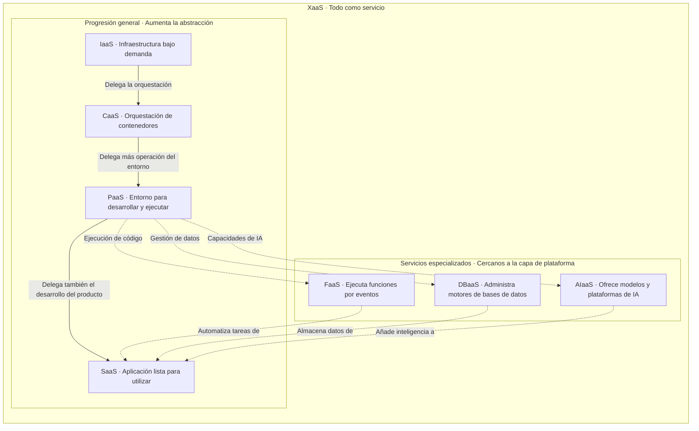

# Practica No.3: Modelos de servicio y modelos de despliegue en la nube

## Actividad 1. Investigación y mapa conceptual de modelos de servicio

Los modelos de servicio en la nube se diferencian por los recursos que ofrecen y las responsabilidades que asume el proveedor. A mayor abstracción, el usuario administra menos componentes técnicos y se concentra más en desarrollar aplicaciones o utilizar sus funciones. En todos los modelos, conserva responsabilidades sobre sus datos, identidades y permisos de acceso.
 general que agrupa la entrega de capacidades tecnológicas como servicios. 

 ### 1.1. IaaS — Infraestructura como servicio

**Infrastructure as a Service**

Ofrece recursos de infraestructura bajo demanda, como máquinas virtuales, almacenamiento y redes. Permite utilizar servidores sin adquirir ni mantener el equipo físico.

| Aspecto | Descripción |
|---|---|
| **El proveedor gestiona** | Centros de datos, servidores físicos, redes físicas, almacenamiento físico y virtualización. |
| **El usuario gestiona** | Sistema operativo, actualizaciones, aplicaciones, datos y configuración de seguridad de sus recursos. |
| **Caso de uso recomendado** | Migrar una aplicación empresarial que requiere un sistema operativo específico y control sobre la configuración del servidor. |
| **Limitación** | Requiere conocimientos de administración de sistemas y mantenimiento continuo. |

**Servicios:**

- **AWS:** Amazon EC2.
- **Microsoft Azure:** Azure Virtual Machines.
- **Google Cloud:** Compute Engine.

### 1.2. PaaS — Plataforma como servicio

**Platform as a Service**

Proporciona un entorno administrado para desarrollar, desplegar y ejecutar aplicaciones. Reduce el trabajo necesario para operar la infraestructura y el entorno de ejecución.

| Aspecto | Descripción |
|---|---|
| **El proveedor gestiona** | Infraestructura, sistema operativo y componentes de la plataforma de ejecución, según el servicio contratado. |
| **El usuario gestiona** | Código, dependencias de la aplicación, datos, permisos y configuración. |
| **Caso de uso recomendado** | Publicar una aplicación web o API cuando el equipo necesita concentrarse en desarrollar funcionalidades. |
| **Limitación** | Los lenguajes, versiones y configuraciones disponibles dependen de la plataforma. |

**Servicios:**

- **AWS:** AWS Elastic Beanstalk.
- **Microsoft Azure:** Azure App Service.
- **Google Cloud:** App Engine.

### 1.3. SaaS — Software como servicio

**Software as a Service**

Entrega una aplicación terminada que se utiliza por internet, normalmente mediante una suscripción. El usuario aprovecha sus funciones sin desarrollar ni mantener el software.

| Aspecto | Descripción |
|---|---|
| **El proveedor gestiona** | Aplicación, infraestructura, plataforma, actualizaciones y operación técnica. |
| **El usuario gestiona** | Cuentas, permisos, información cargada y configuración funcional. |
| **Caso de uso recomendado** | Incorporar correo electrónico, colaboración o gestión de clientes sin desarrollar un sistema propio. |
| **Limitación** | La personalización y el control sobre el funcionamiento interno son limitados. |

**Servicios:**

- **Microsoft:** Microsoft 365.
- **Google:** Google Workspace.
- **Salesforce:** Sales Cloud.

### 1.4. FaaS — Funciones como servicio

**Function as a Service**

Permite ejecutar funciones de código en respuesta a eventos, como solicitudes HTTP, mensajes o cargas de archivos. Es una modalidad de computación *serverless*.

| Aspecto | Descripción |
|---|---|
| **El proveedor gestiona** | Servidores, infraestructura de ejecución, disponibilidad de la plataforma y mecanismos de escalamiento. |
| **El usuario gestiona** | Código de las funciones, dependencias, eventos de activación, permisos e integraciones. |
| **Caso de uso recomendado** | Generar una miniatura automáticamente cuando se carga una imagen en un almacenamiento en la nube. |
| **Limitación** | Los límites de ejecución y los posibles arranques en frío pueden afectar tareas prolongadas o sensibles a la latencia. |

**Servicios:**

- **AWS:** AWS Lambda.
- **Microsoft Azure:** Azure Functions.
- **Google Cloud:** Cloud Run functions.
- 
### 1.5. CaaS — Contenedores como servicio

**Containers as a Service**

Ofrece un entorno para desplegar y administrar aplicaciones empaquetadas en contenedores. Frecuentemente utiliza Kubernetes para coordinar su ejecución.

| Aspecto | Descripción |
|---|---|
| **El proveedor gestiona** | Componentes administrados de la plataforma de orquestación e infraestructura, según la modalidad contratada. |
| **El usuario gestiona** | Imágenes de contenedores, aplicaciones, dependencias, secretos y configuración de despliegue. En algunas modalidades también administra nodos. |
| **Caso de uso recomendado** | Ejecutar microservicios que necesitan portabilidad, escalamiento independiente y control sobre sus despliegues. |
| **Limitación** | Requiere conocimientos de contenedores, redes y orquestación. |

**Servicios:**

- **AWS:** Amazon Elastic Kubernetes Service — EKS.
- **Microsoft Azure:** Azure Kubernetes Service — AKS.
- **Google Cloud:** Google Kubernetes Engine — GKE.

### 1.6. DBaaS — Base de datos como servicio

**Database as a Service**

Proporciona una base de datos administrada. El proveedor se encarga de buena parte de la operación del motor y la infraestructura.

| Aspecto | Descripción |
|---|---|
| **El proveedor gestiona** | Infraestructura, instalación del motor, mantenimiento y mecanismos de respaldo y disponibilidad incluidos en el servicio. |
| **El usuario gestiona** | Datos, esquemas, consultas, índices, usuarios, permisos y políticas configurables. |
| **Caso de uso recomendado** | Almacenar pedidos y clientes de una tienda en línea sin operar directamente los servidores de base de datos. |
| **Limitación** | Puede restringir extensiones, configuraciones avanzadas y acceso administrativo al motor. |

**Servicios:**

- **AWS:** Amazon RDS.
- **Microsoft Azure:** Azure SQL Database.
- **Google Cloud:** Cloud SQL.

### 1.7. AIaaS — Inteligencia artificial como servicio

**Artificial Intelligence as a Service**

Ofrece capacidades de inteligencia artificial mediante APIs o plataformas administradas. Puede incluir generación de texto, reconocimiento de imágenes y herramientas para utilizar o adaptar modelos.

| Aspecto | Descripción |
|---|---|
| **El proveedor gestiona** | Infraestructura de cómputo, plataforma y operación de los modelos ofrecidos, según la modalidad. |
| **El usuario gestiona** | Integración, datos enviados, instrucciones o prompts, permisos y evaluación de resultados. |
| **Caso de uso recomendado** | Integrar un asistente que responda preguntas sobre documentos empresariales sin construir un modelo desde cero. |
| **Limitación** | Los resultados pueden contener errores y requieren evaluación antes de utilizarse en decisiones importantes. |

**Servicios:**

- **AWS:** Amazon Bedrock.
- **Microsoft Azure:** Azure OpenAI.
- **Google Cloud:** Vertex AI.

### 1.8. XaaS — Todo como servicio

**Anything as a Service**

Es un concepto general que agrupa la entrega de capacidades tecnológicas como servicios. La letra “X” representa diferentes recursos o funciones.

| Aspecto | Descripción |
|---|---|
| **El proveedor gestiona** | Los componentes establecidos por cada servicio y contrato. |
| **El usuario gestiona** | Configuración, integración, información y responsabilidades que no se delegan al proveedor. |
| **Caso de uso recomendado** | Combinar infraestructura, aplicaciones y bases de datos contratadas como servicios para reducir la operación de recursos propios. |
| **Limitación** | La combinación de servicios puede aumentar la dependencia de proveedores y la complejidad de integración y costos. |

**Servicios:**

- **AWS:** Amazon EC2, como ejemplo de IaaS.
- **Microsoft:** Microsoft 365, como ejemplo de SaaS.
- **Google Cloud:** Cloud SQL, como ejemplo de DBaaS.

| Modelo | Tú gestionas | Proveedor gestiona | Ejemplo AWS | Ejemplo Azure | Ejemplo GCP |
|---|---|---|---|---|---|
| **IaaS** | Sistema operativo, parches, aplicaciones, datos y configuración de seguridad. | Hardware, redes físicas, almacenamiento físico y virtualización. | Amazon EC2 | Azure Virtual Machines | Compute Engine |
| **PaaS** | Código, dependencias, datos y configuración de la aplicación. | Infraestructura y plataforma de ejecución, según la oferta. | AWS Elastic Beanstalk | Azure App Service | App Engine |
| **SaaS** | Usuarios, permisos, datos y configuración funcional. | Aplicación, plataforma, infraestructura y actualizaciones. | Amazon WorkMail | Microsoft 365¹ | Google Workspace¹ |
| **FaaS** | Funciones, dependencias, disparadores, permisos e integraciones. | Infraestructura, entorno de ejecución y escalamiento. | AWS Lambda | Azure Functions | Cloud Run functions |
| **CaaS** | Contenedores, aplicaciones, despliegues y secretos; nodos según la modalidad. | Orquestación administrada e infraestructura según la modalidad. | Amazon EKS | Azure Kubernetes Service | Google Kubernetes Engine |

## Ejercicio 2: Análisis comparativo de modelos de despliegue 

### 1.2. Nube privada

| Aspecto | Descripción |
|---|---|
| **Definición** | Entorno de nube dedicado exclusivamente a una organización. Puede alojarse en sus instalaciones o ser operado por un tercero. |
| **Ventajas** | Mayor control sobre configuraciones y accesos; personalización; recursos dedicados a las necesidades de la organización. |
| **Desventajas** | Mayor inversión y esfuerzo operativo; necesidad de personal especializado; capacidad limitada por los recursos disponibles. |
| **Organización beneficiada** | Centros de investigación, grandes empresas y organizaciones con requisitos particulares de control o infraestructura. |
| **Ejemplo real** | **CERN opera una nube privada basada en OpenStack** para proporcionar infraestructura como servicio a sus proyectos y usuarios. [2] |

### 1.3. Nube híbrida

| Aspecto | Descripción |
|---|---|
| **Definición** | Integra infraestructura privada o local con servicios de nube pública, permitiendo que ambos entornos colaboren. |
| **Ventajas** | Conserva sistemas y datos seleccionados en el entorno local; aprovecha la capacidad de la nube pública; facilita migraciones graduales. |
| **Desventajas** | Integración compleja; administración de seguridad en varios entornos; costos de conectividad y sincronización. |
| **Organización beneficiada** | Hospitales, bancos y empresas con sistemas existentes que necesitan modernizarse sin migrar toda su operación de una sola vez. |
| **Ejemplo real** | **Liberty Latin America utiliza AWS Outposts y AWS Local Zones** para conectar infraestructura local con servicios de AWS y atender operaciones de telecomunicaciones en Puerto Rico. [3] |

### 1.4. Multi-cloud

| Aspecto | Descripción |
|---|---|
| **Definición** | Uso de servicios de dos o más proveedores de nube. Cada proveedor puede atender una necesidad diferente. |
| **Ventajas** | Permite elegir servicios especializados; reduce la concentración en un proveedor; puede mejorar la capacidad de negociación y las opciones de recuperación. |
| **Desventajas** | Mayor complejidad de administración; diferencias entre herramientas y permisos; costos de transferencia de datos y capacitación. |
| **Organización beneficiada** | Empresas grandes que requieren capacidades de distintos proveedores o buscan diversificar sus dependencias tecnológicas. |
| **Ejemplo real** | **Veritas documentó el uso de Oracle Database Service for Microsoft Azure** para simplificar un entorno multi-cloud de análisis de datos que combina servicios de Azure y Oracle Cloud Infrastructure. [4] |

### 1.5. Nube distribuida

| Aspecto | Descripción |
|---|---|
| **Definición** | Distribuye servicios de nube en distintas ubicaciones físicas y mantiene una administración coordinada. Puede incluir regiones, instalaciones locales y ubicaciones cercanas a los usuarios. |
| **Ventajas** | Acerca el procesamiento a las cargas de trabajo; reduce latencia; permite atender requisitos de ubicación y mantener políticas comunes. |
| **Desventajas** | Dificulta la coordinación entre sitios; exige controlar versiones y configuraciones; depende de la conectividad y capacidad de cada ubicación. |
| **Organización beneficiada** | Empresas con sucursales, operaciones internacionales o usuarios distribuidos geográficamente. |
| **Ejemplo real** | **Netflix implementó estaciones de trabajo para efectos visuales mediante AWS Local Zones**, acercando recursos de cómputo a sus artistas. Ilustra la distribución de servicios de nube fuera de las regiones principales. [5] |

### 1.6. Edge computing

| Aspecto | Descripción |
|---|---|
| **Definición** | Procesa información cerca del lugar donde se genera, por ejemplo en sensores, equipos industriales o servidores locales, antes de enviar todo o parte de los datos a una nube central. |
| **Ventajas** | Menor latencia; menor consumo de ancho de banda; posibilidad de mantener funciones locales ante interrupciones de internet, si se diseñan para ello. |
| **Desventajas** | Capacidad local limitada; mantenimiento de numerosos dispositivos; mayor exposición física de los equipos. |
| **Organización beneficiada** | Fábricas, empresas energéticas, operadores logísticos y organizaciones con dispositivos conectados o procesos sensibles al tiempo de respuesta. |
| **Ejemplo real** | **i GRID LAB utiliza AWS IoT Greengrass** para recopilar datos de dispositivos en el borde dentro de su plataforma energética R.E.A.L., integrada con servicios de análisis en la nube. [6] |

### 1.7. Nube soberana

| Aspecto | Descripción |
|---|---|
| **Definición** | Entorno diseñado para responder a requisitos de jurisdicción, residencia de datos y control operativo. Considera dónde se almacena la información, quién puede acceder y bajo qué condiciones. |
| **Ventajas** | Mayor control sobre ubicación y accesos; apoyo al cumplimiento regulatorio; posibilidad de establecer restricciones operativas y de gestión de claves. |
| **Desventajas** | Puede tener mayor costo; catálogo de servicios más limitado; requiere verificar que las garantías técnicas y contractuales cubran las necesidades reales. |
| **Organización beneficiada** | Dependencias gubernamentales, entidades financieras y organizaciones que manejan información especialmente sensible. |
| **Ejemplo real** | **Lengoo utilizó T-Systems Sovereign Cloud, basada en Google Cloud**, para sus soluciones de traducción con IA y requisitos de confidencialidad, según un caso publicado por T-Systems. [7] |

### 1.8. Nube comunitaria

| Aspecto | Descripción |
|---|---|
| **Definición** | Infraestructura compartida por varias organizaciones con objetivos, políticas o necesidades comunes. Su acceso se orienta a esa comunidad. |
| **Ventajas** | Distribuye costos; facilita la colaboración; permite acordar políticas adaptadas a necesidades compartidas. |
| **Desventajas** | Requiere acuerdos de gobierno y financiamiento; puede haber conflictos por prioridades; tiene una capacidad condicionada por los recursos de la comunidad. |
| **Organización beneficiada** | Universidades, centros de investigación, consorcios hospitalarios y organismos públicos que colaboran entre sí. |
| **Ejemplo real** | **EGI Federated Cloud reúne nubes de investigación** para proporcionar recursos a la comunidad científica. Ilustra un enfoque comunitario implementado mediante una federación de proveedores. [8] |

### a) ¿Por qué una empresa mexicana del sector salud podría preferir una nube híbrida en lugar de una nube pública?

Una empresa mexicana del sector salud podría preferir una nube híbrida porque le permite conservar los expedientes clínicos y sistemas críticos en un entorno privado, mientras utiliza la nube pública para aplicaciones como portales informativos o servicios de citas. Esta combinación facilita aprovechar la infraestructura existente y modernizar los sistemas de manera gradual. También permite mantener determinadas operaciones locales cuando falla la conexión a internet, siempre que la arquitectura esté preparada para ello. Sin embargo, utilizar una nube privada no garantiza automáticamente mayor seguridad: en ambos entornos deben establecerse controles de acceso, cifrado, respaldos y medidas de protección de los datos personales.

### b) ¿Qué ventaja tiene el modelo multi-cloud sobre depender de un solo proveedor? ¿Cuál es su principal desafío?

La principal ventaja del modelo multi-cloud es que permite elegir los servicios más adecuados de diferentes proveedores y reducir la concentración de dependencias tecnológicas. Por ejemplo, una empresa puede ejecutar sus aplicaciones en Azure y utilizar bases de datos de Oracle Cloud. También puede preparar alternativas de recuperación ante interrupciones, aunque estas deben diseñarse y probarse. Su principal desafío es la complejidad operativa: cada proveedor utiliza herramientas, permisos, redes y esquemas de cobro diferentes. Por ello, la organización necesita personal capacitado y mecanismos para coordinar la seguridad, el monitoreo, los costos y el intercambio de información entre plataformas.

### c) Con la apertura de regiones de AWS, Azure, GCP y Alibaba en Querétaro, ¿qué implicaciones tiene para la soberanía de datos en México? ¿Será suficiente para cumplir con la Ley Federal de Protección de Datos Personales?

La disponibilidad de regiones en México facilita almacenar y procesar datos dentro del país y reduce la latencia. Sin embargo, residencia y soberanía no son equivalentes: también importa quién controla los accesos, las claves y la operación. AWS, Azure y GCP documentan infraestructura en Querétaro; el anuncio oficial consultado de Alibaba confirma México, sin precisar ese estado. Alojar datos en territorio nacional no basta para cumplir la Ley Federal de Protección de Datos Personales en Posesión de los Particulares. También deben atenderse las obligaciones de privacidad, seguridad, consentimiento cuando corresponda y derechos ARCO, además de revisar contratos, respaldos y transferencias de información.

### d) ¿En qué escenarios el edge computing ofrece ventajas sobre el cloud centralizado? Menciona al menos dos industrias específicas.

El edge computing ofrece ventajas cuando se requieren respuestas rápidas, se generan grandes volúmenes de información o la conexión a internet es inestable. En la industria manufacturera, permite analizar imágenes de productos junto a la línea de producción y detectar defectos sin enviar todo el video a una nube central. En la industria energética, permite procesar mediciones de paneles solares, baterías o instalaciones remotas cerca de su origen y enviar únicamente los datos necesarios a la nube. En ambos casos, disminuye la latencia y el consumo de ancho de banda. La nube central complementa este procesamiento con análisis históricos, almacenamiento y coordinación entre instalaciones.

