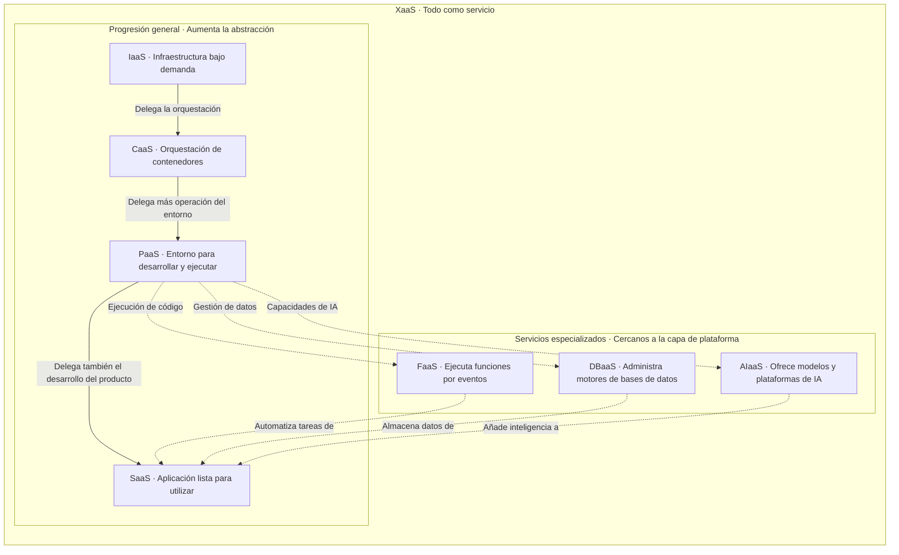

# Practica No.3: Modelos de servicio y modelos de despliegue en la nube

## Actividad 1. Investigación y mapa conceptual de modelos de servicio

Los modelos de servicio en la nube se diferencian por los recursos que ofrecen y las responsabilidades que asume el proveedor. A mayor abstracción, el usuario administra menos componentes técnicos y se concentra más en desarrollar aplicaciones o utilizar sus funciones. En todos los modelos, conserva responsabilidades sobre sus datos, identidades y permisos de acceso.
 general que agrupa la entrega de capacidades tecnológicas como servicios. 

 ### 1.1. IaaS — Infraestructura como servicio

**Infrastructure as a Service**

Ofrece recursos de infraestructura bajo demanda, como máquinas virtuales, almacenamiento y redes. Permite utilizar servidores sin adquirir ni mantener el equipo físico.

| Aspecto | Descripción |
|---|---|
| **El proveedor gestiona** | Centros de datos, servidores físicos, redes físicas, almacenamiento físico y virtualización. |
| **El usuario gestiona** | Sistema operativo, actualizaciones, aplicaciones, datos y configuración de seguridad de sus recursos. |
| **Caso de uso recomendado** | Migrar una aplicación empresarial que requiere un sistema operativo específico y control sobre la configuración del servidor. |
| **Limitación** | Requiere conocimientos de administración de sistemas y mantenimiento continuo. |

**Servicios reales:**

- **AWS:** Amazon EC2.
- **Microsoft Azure:** Azure Virtual Machines.
- **Google Cloud:** Compute Engine.

### 1.2. PaaS — Plataforma como servicio

**Platform as a Service**

Proporciona un entorno administrado para desarrollar, desplegar y ejecutar aplicaciones. Reduce el trabajo necesario para operar la infraestructura y el entorno de ejecución.

| Aspecto | Descripción |
|---|---|
| **El proveedor gestiona** | Infraestructura, sistema operativo y componentes de la plataforma de ejecución, según el servicio contratado. |
| **El usuario gestiona** | Código, dependencias de la aplicación, datos, permisos y configuración. |
| **Caso de uso recomendado** | Publicar una aplicación web o API cuando el equipo necesita concentrarse en desarrollar funcionalidades. |
| **Limitación** | Los lenguajes, versiones y configuraciones disponibles dependen de la plataforma. |

**Servicios reales:**

- **AWS:** AWS Elastic Beanstalk.
- **Microsoft Azure:** Azure App Service.
- **Google Cloud:** App Engine.

### 1.3. SaaS — Software como servicio

**Software as a Service**

Entrega una aplicación terminada que se utiliza por internet, normalmente mediante una suscripción. El usuario aprovecha sus funciones sin desarrollar ni mantener el software.

| Aspecto | Descripción |
|---|---|
| **El proveedor gestiona** | Aplicación, infraestructura, plataforma, actualizaciones y operación técnica. |
| **El usuario gestiona** | Cuentas, permisos, información cargada y configuración funcional. |
| **Caso de uso recomendado** | Incorporar correo electrónico, colaboración o gestión de clientes sin desarrollar un sistema propio. |
| **Limitación** | La personalización y el control sobre el funcionamiento interno son limitados. |

**Servicios reales:**

- **Microsoft:** Microsoft 365.
- **Google:** Google Workspace.
- **Salesforce:** Sales Cloud.

### 1.4. FaaS — Funciones como servicio

**Function as a Service**

Permite ejecutar funciones de código en respuesta a eventos, como solicitudes HTTP, mensajes o cargas de archivos. Es una modalidad de computación *serverless*.

| Aspecto | Descripción |
|---|---|
| **El proveedor gestiona** | Servidores, infraestructura de ejecución, disponibilidad de la plataforma y mecanismos de escalamiento. |
| **El usuario gestiona** | Código de las funciones, dependencias, eventos de activación, permisos e integraciones. |
| **Caso de uso recomendado** | Generar una miniatura automáticamente cuando se carga una imagen en un almacenamiento en la nube. |
| **Limitación** | Los límites de ejecución y los posibles arranques en frío pueden afectar tareas prolongadas o sensibles a la latencia. |

**Servicios reales:**

- **AWS:** AWS Lambda.
- **Microsoft Azure:** Azure Functions.
- **Google Cloud:** Cloud Run functions.
- 
### 1.5. CaaS — Contenedores como servicio

**Containers as a Service**

Ofrece un entorno para desplegar y administrar aplicaciones empaquetadas en contenedores. Frecuentemente utiliza Kubernetes para coordinar su ejecución.

| Aspecto | Descripción |
|---|---|
| **El proveedor gestiona** | Componentes administrados de la plataforma de orquestación e infraestructura, según la modalidad contratada. |
| **El usuario gestiona** | Imágenes de contenedores, aplicaciones, dependencias, secretos y configuración de despliegue. En algunas modalidades también administra nodos. |
| **Caso de uso recomendado** | Ejecutar microservicios que necesitan portabilidad, escalamiento independiente y control sobre sus despliegues. |
| **Limitación** | Requiere conocimientos de contenedores, redes y orquestación. |

**Servicios reales:**

- **AWS:** Amazon Elastic Kubernetes Service — EKS.
- **Microsoft Azure:** Azure Kubernetes Service — AKS.
- **Google Cloud:** Google Kubernetes Engine — GKE.

### 1.6. DBaaS — Base de datos como servicio

**Database as a Service**

Proporciona una base de datos administrada. El proveedor se encarga de buena parte de la operación del motor y la infraestructura.

| Aspecto | Descripción |
|---|---|
| **El proveedor gestiona** | Infraestructura, instalación del motor, mantenimiento y mecanismos de respaldo y disponibilidad incluidos en el servicio. |
| **El usuario gestiona** | Datos, esquemas, consultas, índices, usuarios, permisos y políticas configurables. |
| **Caso de uso recomendado** | Almacenar pedidos y clientes de una tienda en línea sin operar directamente los servidores de base de datos. |
| **Limitación** | Puede restringir extensiones, configuraciones avanzadas y acceso administrativo al motor. |

**Servicios reales:**

- **AWS:** Amazon RDS.
- **Microsoft Azure:** Azure SQL Database.
- **Google Cloud:** Cloud SQL.

### 1.7. AIaaS — Inteligencia artificial como servicio

**Artificial Intelligence as a Service**

Ofrece capacidades de inteligencia artificial mediante APIs o plataformas administradas. Puede incluir generación de texto, reconocimiento de imágenes y herramientas para utilizar o adaptar modelos.

| Aspecto | Descripción |
|---|---|
| **El proveedor gestiona** | Infraestructura de cómputo, plataforma y operación de los modelos ofrecidos, según la modalidad. |
| **El usuario gestiona** | Integración, datos enviados, instrucciones o prompts, permisos y evaluación de resultados. |
| **Caso de uso recomendado** | Integrar un asistente que responda preguntas sobre documentos empresariales sin construir un modelo desde cero. |
| **Limitación** | Los resultados pueden contener errores y requieren evaluación antes de utilizarse en decisiones importantes. |

**Servicios reales:**

- **AWS:** Amazon Bedrock.
- **Microsoft Azure:** Azure OpenAI.
- **Google Cloud:** Vertex AI.

### 1.8. XaaS — Todo como servicio

**Anything as a Service**

Es un concepto general que agrupa la entrega de capacidades tecnológicas como servicios. La letra “X” representa diferentes recursos o funciones.

| Aspecto | Descripción |
|---|---|
| **El proveedor gestiona** | Los componentes establecidos por cada servicio y contrato. |
| **El usuario gestiona** | Configuración, integración, información y responsabilidades que no se delegan al proveedor. |
| **Caso de uso recomendado** | Combinar infraestructura, aplicaciones y bases de datos contratadas como servicios para reducir la operación de recursos propios. |
| **Limitación** | La combinación de servicios puede aumentar la dependencia de proveedores y la complejidad de integración y costos. |

**Servicios reales que pertenecen a XaaS:**

- **AWS:** Amazon EC2, como ejemplo de IaaS.
- **Microsoft:** Microsoft 365, como ejemplo de SaaS.
- **Google Cloud:** Cloud SQL, como ejemplo de DBaaS.

