# PRÁCTICA 4 — PROVEEDORES DE SERVICIO EN LA NUBE

**Instituto Politécnico Nacional — ESCOM**  
**Unidad de aprendizaje:** Sistemas Distribuidos  
**Edición del instructivo:** 2025  
**Grupo:** 7CV1  
**Equipo:** 8  
**Integrantes:** Israel Márquez Cárdenas | Esaul Tellez de la Cruz | Salvador Sandoval Garibay
**Fecha de elaboración:** 25 de octubre de 2026  

> **Estado de elaboración:** Investigación y análisis preparados. Los campos `[EVIDENCIA REAL PENDIENTE]` no deben rellenarse con valores simulados: requieren capturas, cotizaciones oficiales y/o mediciones obtenidas por el equipo. El PDF de origen se titula *Práctica 4*, aunque sus pies de página y nombre de entrega contienen el número *2*; confirmar la nomenclatura de entrega con el docente.

## Objetivo

Comparar Amazon Web Services (AWS), Microsoft Azure, Google Cloud (GCP) y Oracle Cloud Infrastructure (OCI) mediante servicios equivalentes, estructura de precios, acuerdos de nivel de servicio, regiones mexicanas y estrategias de migración. Para el proyecto escolar se consideran las necesidades de una Mesa de Ayuda: API web, registro de tickets, almacenamiento de adjuntos, autenticación, disponibilidad y costos controlados.

## Actividad 1. Tabla maestra de equivalencia de servicios

### 1.1 Tabla de diez categorías

Los siguientes nombres corresponden a servicios reales. Las características y unidades de cobro pueden cambiar por modalidad o región. **No son cotizaciones:** las tarifas numéricas se verifican en la Actividad 2 usando la calculadora oficial.

| Categoría | AWS | Azure | Google Cloud | OCI | Mejor opción para la Mesa de Ayuda |
|---|---|---|---|---|---|
| VMs de propósito general | Amazon EC2 | Azure Virtual Machines | Compute Engine | OCI Compute | **Azure**: integración de identidad y herramientas Microsoft |
| Funciones serverless | AWS Lambda | Azure Functions | Cloud Run functions | OCI Functions | **AWS Lambda**: madurez, integración con eventos y escalado por invocación |
| Objetos | Amazon S3 | Blob Storage | Cloud Storage | Object Storage | **S3**: amplio ecosistema y opciones de ciclo de vida |
| BD relacional gestionada | Amazon RDS | Azure Database for MySQL / PostgreSQL | Cloud SQL | MySQL HeatWave / OCI Database | **Azure Database for MySQL** si la aplicación se hospeda en Azure |
| BD NoSQL | DynamoDB | Cosmos DB | Firestore | OCI NoSQL Database | **Firestore**: modelo documental sencillo para prototipos |
| Kubernetes gestionado | Amazon EKS | Azure Kubernetes Service (AKS) | Google Kubernetes Engine (GKE) | Oracle Kubernetes Engine (OKE) | **AKS**: opción para integración con Azure, aunque excesiva para el prototipo |
| CDN | CloudFront | Azure Front Door | Cloud CDN | OCI CDN / Web Application Acceleration según catálogo | **CloudFront**: distribución global y relación con S3 |
| DNS gestionado | Route 53 | Azure DNS | Cloud DNS | OCI DNS | **Azure DNS** si el resto del proyecto se opera en Azure |
| IA generativa vía API | Amazon Bedrock | Azure AI Foundry / Azure OpenAI | Vertex AI | OCI Generative AI | **Azure AI Foundry** para un asistente de clasificación de tickets, sujeto a costos |
| Monitoreo y observabilidad | CloudWatch | Azure Monitor / Application Insights | Cloud Monitoring / Logging | OCI Monitoring / Logging | **Application Insights**: trazas y fallas de aplicación centralizadas |

**Criterio de “mejor opción”.** No existe ganador absoluto: depende de infraestructura ya utilizada, costos específicos, necesidades de integración y complejidad operativa. Las elecciones de la última columna son recomendaciones de arquitectura para un sistema escolar, no un ranking global.

### 1.2 Precios base y diferenciadores

La siguiente tabla conserva tarifas **ilustrativas de la edición 2025 del enunciado**, únicamente cuando ese documento ofrece una cifra común. No se deben presentar como precios de octubre de 2026 ni extrapolar a todas las regiones.

| Categoría | Precio base / unidad a verificar | Diferenciador relevante |
|---|---|---|
| VM | Referencia histórica del enunciado: AWS **USD 0.096/h**, Azure **0.096/h**, GCP **0.067/h**, OCI **0.050/h** para una VM anunciada como 2 vCPU/8 GB | Familias, CPU, disco, red y descuentos varían; comprobar región y SKU |
| Funciones | Referencia histórica: AWS **USD 0.20/1 M** invocaciones, Azure **0.20/1 M**, GCP **0.40/1 M**, OCI **0.20/1 M**; **no incluye duración ni memoria** | Facturación de invocaciones más GB-segundo/vCPU-tiempo |
| Objetos | Referencia histórica: S3 **USD 0.023/GB-mes**, Azure **0.018**, GCP **0.020**, OCI **0.0255**, para clases/regiones no especificadas | Cobro adicional por operaciones, recuperación y transferencia |
| BD relacional | Por instancia/hora + GB-mes + respaldos, según motor | HA, réplicas, respaldo automático y versiones compatibles |
| BD NoSQL | Por lecturas/escrituras, capacidad/provisión y almacenamiento | Elasticidad y consistencia configurables según producto |
| Kubernetes | Referencia histórica de plano de control: EKS **USD 73/mes**, AKS **USD 0** en modalidad básica, GKE **USD 73/mes** antes de créditos y OKE **USD 0** en modalidad básica | **Además** se pagan nodos, almacenamiento, redes y balanceadores |
| CDN | Por GB entregado + solicitudes y funciones opcionales | Caché en borde que reduce respuesta y tráfico al origen |
| DNS | Por zona alojada + consultas | Integración de registros, políticas y salud de endpoints |
| IA generativa | Por cantidad de tokens de entrada/salida o capacidad aprovisionada | Diferentes modelos, privacidad, costo por token y residencia |
| Observabilidad | Por GB de logs, métricas, trazas, retención y consultas | Instrumentación de errores, latencia y alertas |

**Conclusión de la tabla:** para una Mesa de Ayuda escolar es más razonable iniciar con una aplicación web sencilla y una base gestionada o pequeña, antes de introducir Kubernetes o servicios de IA de pago.

### 1.3 Preguntas de análisis

**¿Qué proveedor tiene el catálogo más amplio?** AWS destaca por la amplitud y madurez de su catálogo general y su ecosistema de productos, aunque contar servicios no es una comparación perfecta porque cada empresa agrupa funcionalidades de forma distinta. Es mejor revisar si los productos concretos que necesita el proyecto están disponibles en la región elegida.

**¿Cuál se integra mejor con herramientas que utilizas?** Para una Mesa de Ayuda desarrollada con GitHub y herramientas Microsoft, Azure facilita la integración con Microsoft Entra ID, Application Insights, Azure DevOps y otros productos del ecosistema. No es obligatorio usar Azure para integrar GitHub; la decisión debe validarse con costos y experiencia del equipo.

**¿Cuál tiene la capa gratuita más generosa?** No hay ganador universal. OCI ofrece recursos *Always Free* útiles para VM y base de datos; Google y AWS tienen modalidades gratuitas/créditos con límites; Azure for Students ofrece créditos educativos cuando la cuenta es elegible. Los límites, requisitos, regiones y vencimientos se deben leer en las páginas actuales antes de desplegar. Una capa gratuita no significa que todo recurso sea gratuito.

## Actividad 2. Costos de arquitectura en tres nubes

### 2.1 Supuestos estandarizados

Para comparar **AWS, Azure y GCP**, usar la misma arquitectura y periodo:

- **VM:** 1 instancia Linux, **2 vCPU, 8 GB RAM, 50 GB SSD**, encendida **730 horas/mes**.
- **Objetos:** **100 GB** de almacenamiento estándar/hot/standard; especificar clase y cantidad de operaciones asumidas (si es obligatorio: 10 000 lecturas y 1 000 escrituras/mes, iguales para todos).
- **BD:** **MySQL o PostgreSQL gestionado**, objetivo **2 vCPU, 4 GB RAM y 20 GB de almacenamiento**. Si el proveedor no ofrece exactamente la combinación, seleccionar la opción más cercana e identificar la diferencia.
- **Transferencia:** **500 GB/mes de egreso a internet**; confirmar que no se duplique en el cálculo de VM y balanceador.
- **Balanceador:** 1 balanceador de carga básico compatible con tráfico HTTP(S), **730 horas/mes** y parámetros de uso iguales.
- **Modalidad:** bajo demanda (*pay as you go*), sin impuestos y en USD. Preferir región **México Central / Querétaro**, si el servicio se ofrece ahí; en caso contrario indicar la región sustituta.
- **Créditos gratuitos:** excluirlos de la comparación de costo comercial; reportarlos por separado para no confundir precio de lista con factura educativa.

**Regiones:** AWS `mx-central-1` (México Central), Azure `Mexico Central`, GCP `northamerica-south1` (Querétaro).

### 2.2 Tabla de estimaciones oficiales

| Componente, USD/mes | AWS — México Central | Azure — México Central | GCP — Querétaro |
|---|---:|---:|---:|
| VM + disco | 41.03 | ≈77.38¹ | 76.53 |
| Objetos 100 GB | 2.42 | ≈3.44¹ | 4.60 |
| BD gestionada | 52.06 | ≈137.95¹ | 91.60 |
| Salida a internet | 55.00 | 32.00 | 22.58 |
| Balanceador | 21.45 | No incluido | 19.99 |
| **TOTAL mensual cotizado** | **171.96** | **250.76²** | **215.30** |

¹ Azure muestra importes anuales por servicio, convertidos a mensual dividiendo entre 12 y redondeando a dos decimales. La suma de esos valores redondeados es USD 250.77; el resumen muestra USD 250.76, diferencia de USD 0.01 por redondeo. ² El total de Azure es el de la captura y no incluye balanceador. Las cotizaciones tampoco usan configuraciones idénticas: por ejemplo, la captura EC2 muestra 2 vCPU/4 GiB y la de Cloud Storage de GCP usa ubicación multirregional de Estados Unidos.

**Evidencias:** insertar las capturas originales de los tres resúmenes, indicando fecha, región, moneda, SKU y costos por servicio:

- **Figura 1. Resumen de costos AWS:**

	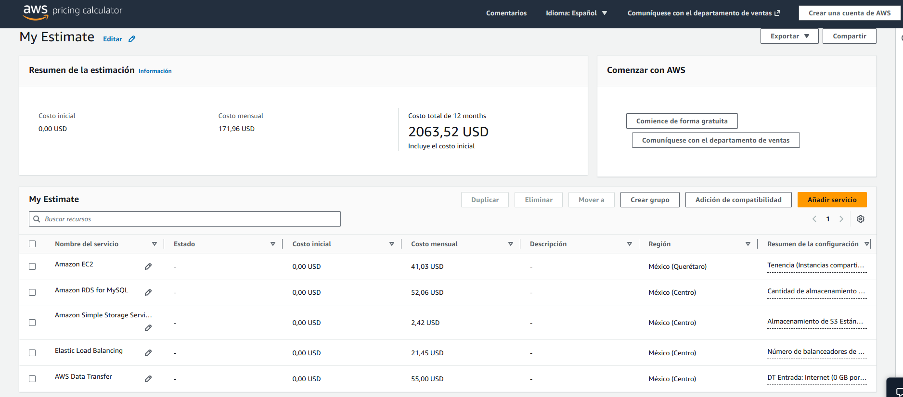

- **Figura 2. Resumen de costos Azure:**

	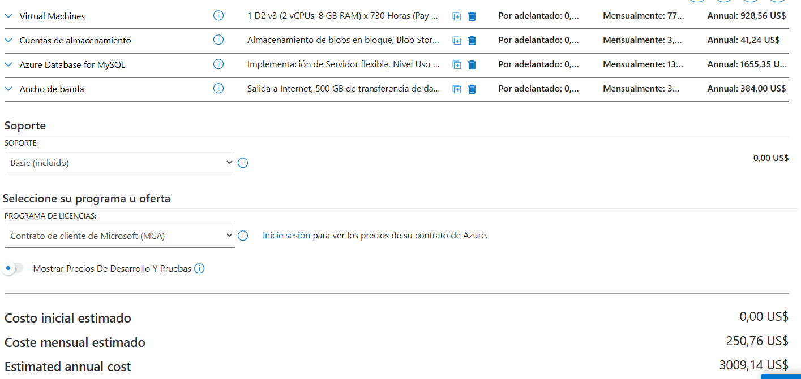

- **Figura 3. Resumen de costos Google Cloud:**

	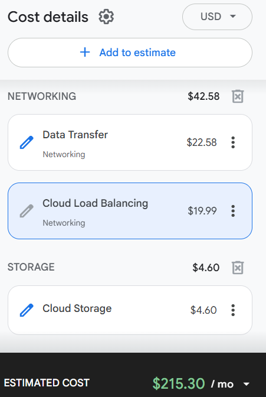

**Capturas de configuración por componente:**

**AWS**

- EC2: 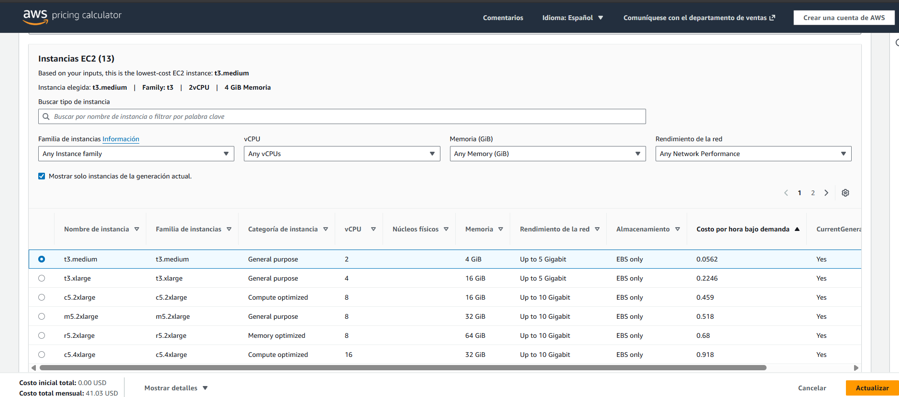
- RDS: 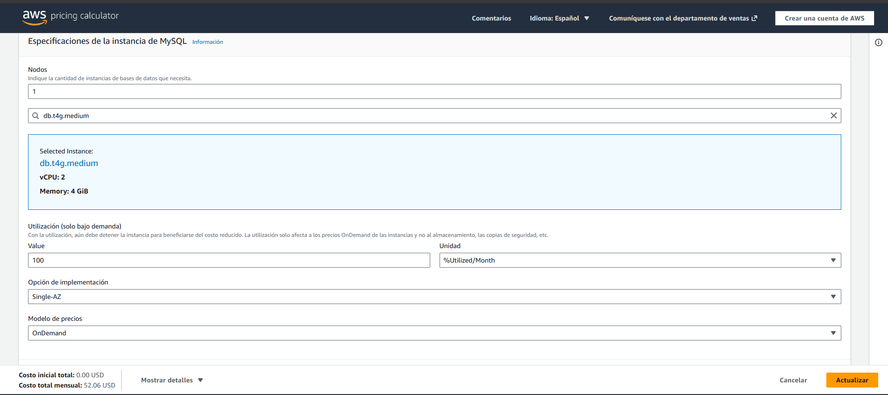
- S3: 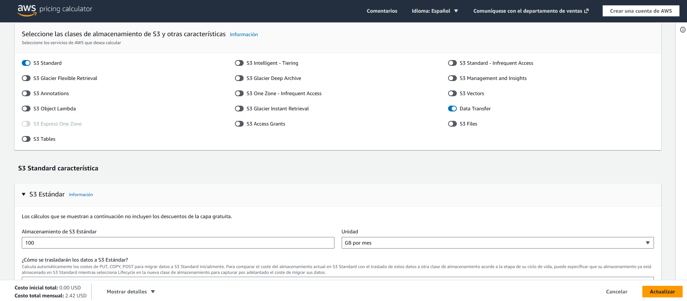
- Balanceador de carga: 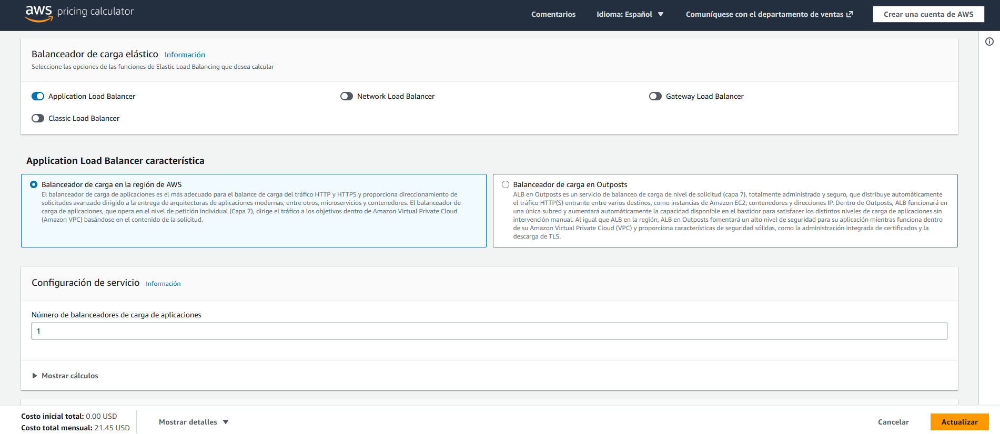

**Azure**

- Máquina virtual: 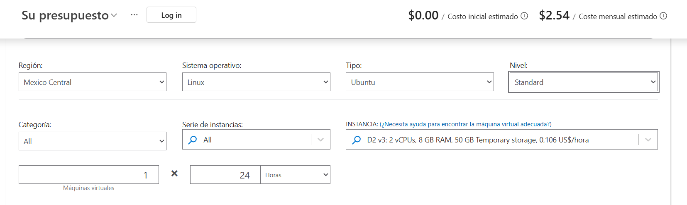
- Almacenamiento: 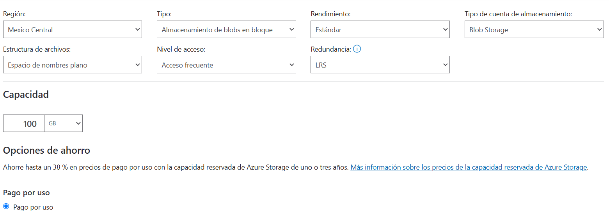
- Base de datos: 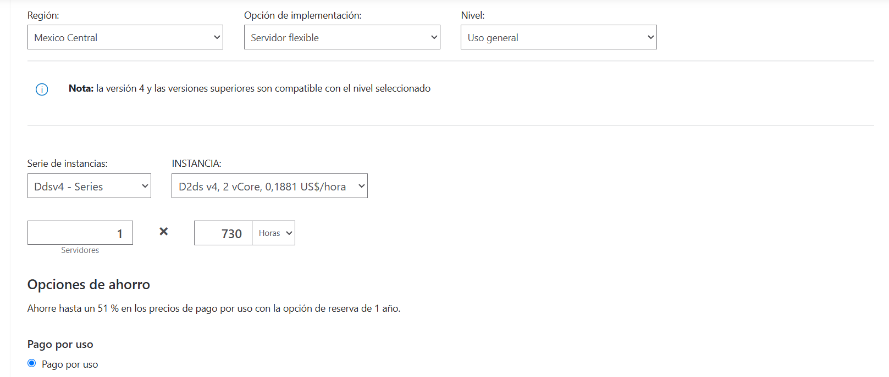
- Transferencia de salida: 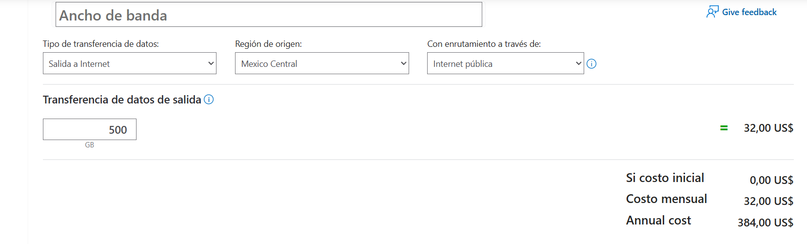

**Google Cloud**

- Compute Engine: 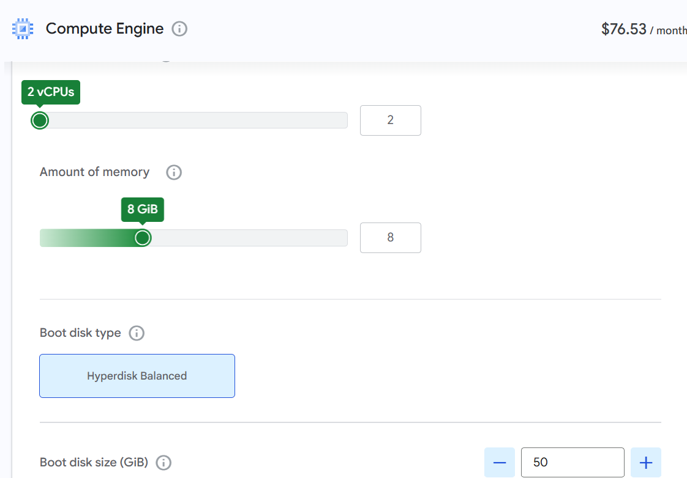
- Cloud Storage: 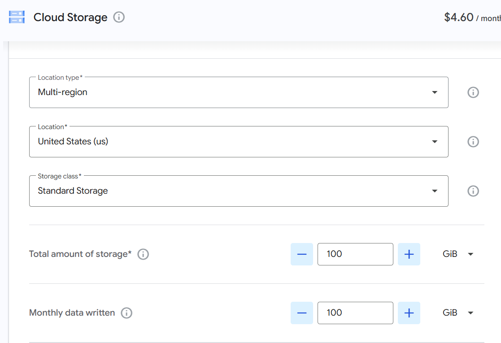
- Base de datos: 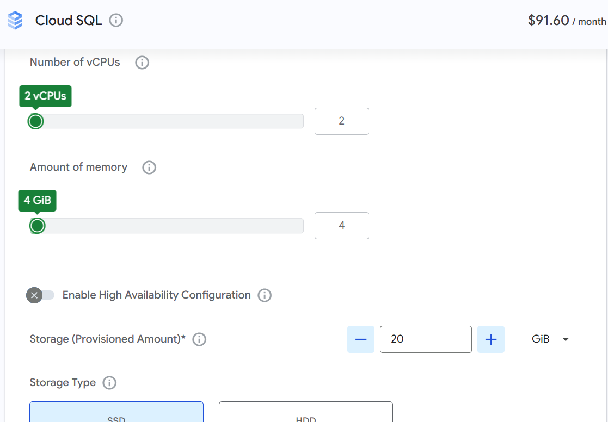
- Transferencia de datos: 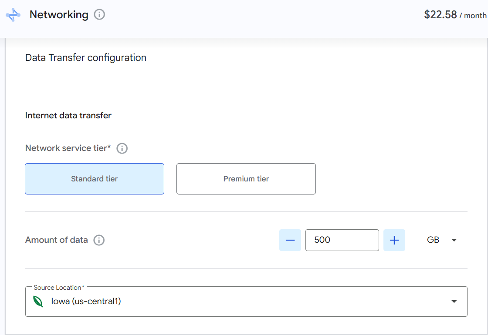
- Balanceador de carga: 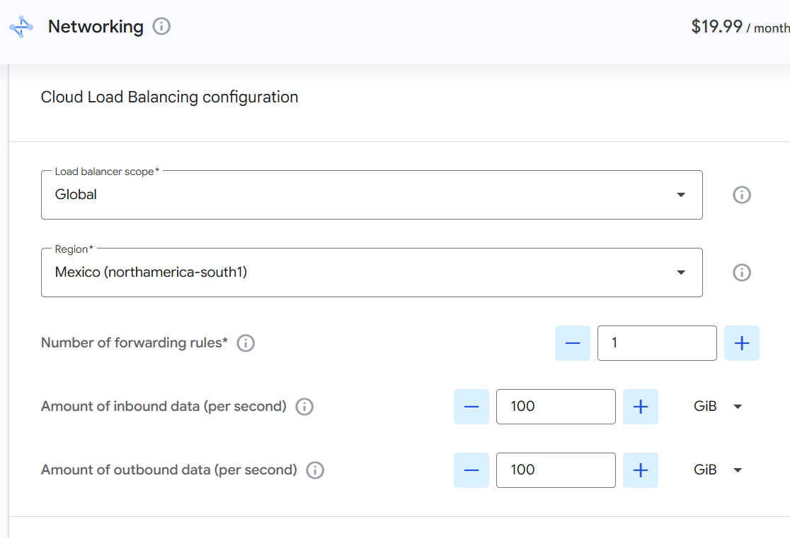

**Rutas oficiales:** AWS https://calculator.aws/ · Azure https://azure.microsoft.com/pricing/calculator/ · GCP https://cloud.google.com/products/calculator

### 2.3 Ahorro anual y conveniencia del cambio

Tomando los totales mensuales visibles de la tabla 2.2:

- `C_mínimo = USD 171.96/mes` (AWS).
- `C_máximo = USD 250.76/mes` (Azure).
- `Ahorro mensual potencial = 250.76 − 171.96 = USD 78.80`.
- `Ahorro anual potencial = 12 × 78.80 = USD 945.60`.
- `Ahorro porcentual = 100 × 78.80 / 250.76 = 31.42 %`.

**Conveniencia del cambio:** la diferencia de precio podría justificar evaluar AWS para una implementación nueva, sin dependencias, siempre que una cotización con arquitectura, región, sistema operativo, almacenamiento, tráfico y balanceador equivalentes confirme el resultado. No basta para recomendar migrar la carga Azure actual: su total no incluye balanceador y las capturas no son completamente homogéneas. Para una carga existente, definir `C_migración` como el costo único de ingeniería, transferencia, capacitación, pruebas y posible interrupción; el plazo de recuperación estimado es `C_migración / USD 78.80` meses (o `C_migración / USD 945.60` años). Si el costo de migración excede el ahorro del periodo de permanencia esperado, el cambio no conviene solo por precio. El cálculo no incluye impuestos, soporte, descuentos contractuales ni variaciones de uso.

### 2.4 Comparación con reserva a un año

Azure es el proveedor más caro de la cotización. La SKU original de la captura es D2 v3 (2 vCPU/8 GiB); Microsoft indica que esa serie no admite Reserved VM Instances. Para mostrar una alternativa reservable de capacidad equivalente, se usa **D2 v4 en Mexico Central** (2 vCPU/8 GiB). No es la misma generación de VM, por lo que se debe tratar como una estimación de referencia, no como una reserva de la SKU D2 v3.

| Concepto, USD/mes | Bajo demanda | Reserva 1 año |
|---|---:|---:|
| VM D2 v4, 2 vCPU/8 GiB, Mexico Central | 77.3800 | 45.3333 |
| Objetos 100 GB | 3.44 | 3.44 |
| Base de datos gestionada | ≈137.95 | ≈137.95 |
| Egreso 500 GB | 32.00 | 32.00 |
| Balanceador | No incluido en cotización | No incluido en cotización |
| **Total mensual equivalente** | **250.76** | **≈218.71** |
| **Ahorro por cómputo** | — | **32.0467/mes** |
| **Ahorro anual por cómputo** | — | **384.5604 (≈384.56)** |

El costo anual equivalente del cómputo pasa de `77.38 × 12 = USD 928.56` a `45.3333 × 12 = USD 544.00`; el ahorro es `USD 384.56`, aproximadamente **41.41 %** del costo de cómputo bajo demanda. El total Azure recalculado conserva los demás importes de la cotización, no agrega balanceador y presenta una diferencia de USD 0.01 por redondeo frente a la suma de líneas.

**Método y condiciones:** la tarifa publicada muestra importes mensuales equivalentes para una instancia reservada por 1 año en Mexico Central. La captura no especifica si la compra se paga por adelantado o mensualmente; confirmar modalidad y términos de pago al adquirir la reserva. El ahorro solo aplica si la VM se mantiene en uso y coincide con las condiciones de la reserva. No se aplicó descuento de reserva a egreso, objetos ni base de datos.

**Figura 4. Precio oficial Azure D2 v4 en Mexico Central, bajo demanda y reservado a 1 año:**

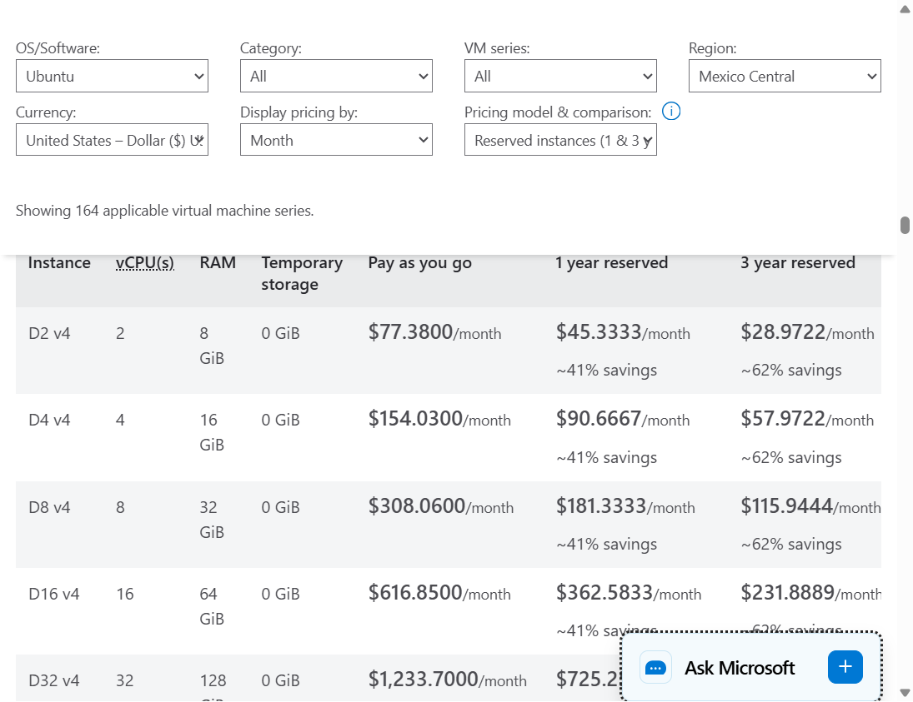

Fuente: [precios de Azure Linux Virtual Machines](https://azure.microsoft.com/en-us/pricing/details/virtual-machines/linux/), consulta 25-oct-2026. La tarifa es pública y puede cambiar; la cotización personalizada puede variar según contrato y moneda.

## Actividad 3. SLA y disponibilidad

### 3.1 Contratos oficiales seleccionados

- **AWS EC2 — Amazon Compute SLA:** instancia individual **99.5 %** mensual; servicio desplegado concurrentemente en al menos dos zonas de disponibilidad en una región, **99.99 %** mensual. Fuente oficial: https://aws.amazon.com/compute/sla/ (consulta: 25-oct-2026).
- **Azure Virtual Machines:** el enunciado 2025 utiliza como ejemplo **95 %** para la configuración individual con disco HDD y **99.99 %** para instancias redundantes en zonas. El compromiso depende de disco y arquitectura; verificar la versión contractual de octubre de 2026 en https://www.microsoft.com/licensing/docs/view/Service-Level-Agreements-SLA-for-Online-Services . Microsoft documenta que dos o más VMs entre zonas pueden alcanzar el SLA **99.99 %**: https://learn.microsoft.com/en-us/azure/virtual-machines/overview .

**Atención:** el SLA del proveedor no es la disponibilidad medida del sistema del equipo. Además, muchos contratos usan ventanas **mensuales**, por lo que la tabla anual siguiente es una **equivalencia matemática teórica** y no un derecho contractual de acumular fallas durante un año.

### 3.2 Tabla de inactividad máxima

Supuestos: año de 365 días = **525 600 minutos**; mes de 30 días = **43 200 minutos**. Fórmula: `tiempo de inactividad = minutos_del_periodo × (1 − SLA/100)`.

| SLA | Disponibilidad anual teórica | Inactividad máxima por año | Inactividad máxima por mes (30 días) |
|---|---:|---:|---:|
| 99 % | 99 % | 5 256 min = 87 h 36 min | 432 min = 7 h 12 min |
| 99.9 % | 99.9 % | 525.6 min = 8 h 45 min 36 s | 43.2 min = 43 min 12 s |
| 99.95 % | 99.95 % | 262.8 min = 4 h 22 min 48 s | 21.6 min = 21 min 36 s |
| 99.99 % | 99.99 % | 52.56 min = 52 min 33.6 s | 4.32 min = 4 min 19.2 s |
| 99.999 % | 99.999 % | 5.256 min = 5 min 15.36 s | 0.432 min = 25.92 s |

**Ejemplo reproducible:** para 99.9 %, `525600 × (1 − 0.999) = 525.6 minutos/año`; `43200 × 0.001 = 43.2 minutos/mes`.

### 3.3 Respuestas

**a) ¿Por qué el ejemplo de Azure pasa de 95 % en HDD a 99.99 % en multi-AZ?** El hardware, el almacenamiento y el alcance de los compromisos son diferentes. Una VM aislada sobre una configuración básica tiene puntos únicos de falla: una interrupción de host o disco puede dejar todo el sistema inoperante. Para acercarse a 99.99 %, distribuiría **al menos dos VM equivalentes entre dos zonas de disponibilidad**, un **balanceador** con verificaciones de salud y una base de datos configurada para alta disponibilidad; un solo nodo de aplicación no basta. La arquitectura debe desplegarse y operarse según las condiciones precisas del contrato de Azure vigente.

**b) Aplicación de USD 10 000 por hora.** Con disponibilidad teórica de 99.9 %, el tiempo máximo calculado equivale a **8.76 horas/año** y una pérdida potencial lineal de **USD 87 600** (`525.6/60 × 10000`). Con 99.99 %, serían **0.876 horas/año** y **USD 8 760**. La reducción teórica es **USD 78 840/año**. Pagar redundancia adicional podría justificarse si su sobrecosto total anual es inferior al daño esperado que evita, pero el cálculo no predice incidentes reales: el SLA fija un umbral contractual, no la cantidad de fallos que ocurrirá ni una indemnización por ventas perdidas.

**c) Incidente de CrowdStrike, 19 de julio de 2024.** Una actualización defectuosa del contenido de CrowdStrike Falcon para Windows provocó pantallas azules y ciclos de reinicio en dispositivos Windows. Afectó entornos locales y VMs hospedadas en diversas plataformas, entre ellas Azure; no fue una caída general provocada por el hipervisor de Azure. La propia Microsoft y CrowdStrike publicaron análisis y guías de recuperación. Una lección es evitar actualizaciones simultáneas en toda la flota, usar despliegues por anillos/canarios, snapshots y rutas de recuperación fuera de banda, diversificar componentes críticos cuando sea razonable, y probar restauraciones. Existió además un **incidente independiente de Azure Central US el 18 de julio**, que no debe confundirse con la actualización de CrowdStrike del día 19. Fuentes: https://azure.status.microsoft/en-us/status/history/?trackingId=1VT1-LX0 ; https://www.crowdstrike.com/en-us/blog/channel-file-291-rca-available/ ; https://blogs.microsoft.com/blog/2024/07/20/helping-our-customers-through-the-crowdstrike-outage/ .

**d) Rendimiento en los SLAs de OCI.** Además de disponibilidad, Oracle comunica compromisos relacionados con la capacidad de gestión y el rendimiento en determinados servicios, bajo métricas y condiciones específicas de su documento contractual. Para una Mesa de Ayuda, si la base de datos tarda demasiado en confirmar la creación de un ticket, el servicio puede estar disponible desde el punto de vista de red y aun así incumplir objetivos del negocio. Un compromiso de IOPS o rendimiento de almacenamiento —cuando se aplica al recurso contratado— permite verificar si el problema se relaciona con la capa gestionada; no reemplaza mediciones end-to-end. Fuente: https://docs.oracle.com/en-us/iaas/Content/General/Reference/slastatement.htm .

## Actividad 4. Regiones de México y latencia

### 4.1 Regiones a identificar en las consolas

| Proveedor | Nombre mostrado | Código | Evidencia requerida |
|---|---|---|---|
| AWS | Mexico (Central) | `mx-central-1` | Captura del selector de región con México visible |
| Azure | Mexico Central | `mexicocentral` | Captura de selección de ubicación/región del recurso, sin crearlo |
| Google Cloud | Querétaro | `northamerica-south1` | Captura de lista de regiones en Compute Engine |
| Oracle Cloud | Mexico Central (Querétaro) / Mexico Northeast (Monterrey) | `mx-queretaro-1` / `mx-monterrey-1` | Captura del selector de región de la tenencia |

**No todas las cuentas ofrecen todas las regiones ni todas las SKU están disponibles en cada región.** No se debe desplegar nada únicamente para tomar estas capturas.

**Figura 5. Selector de región AWS:**

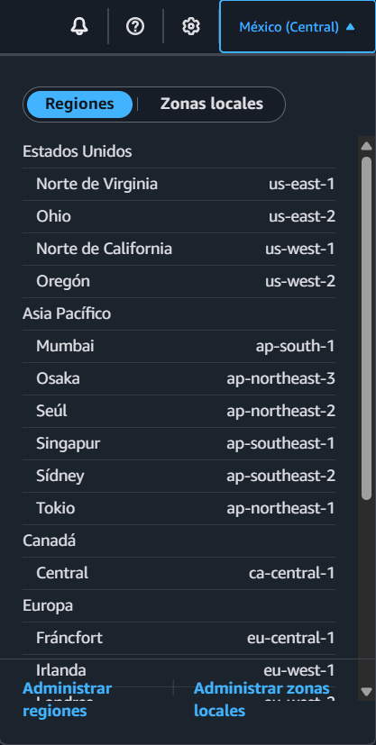

**Figura 6. Selector de región Azure:**

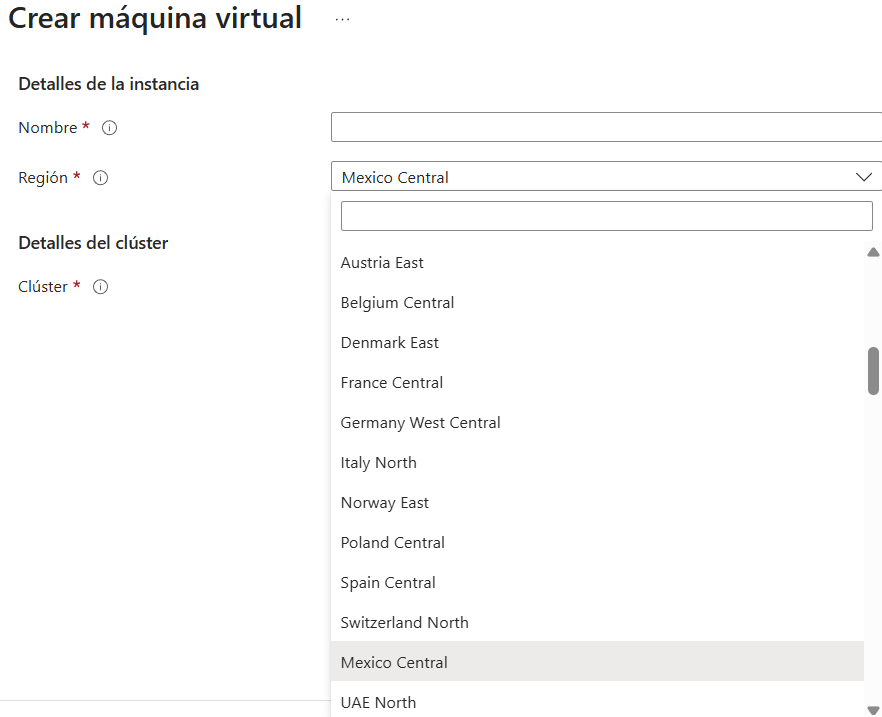

**Figuras 7–8:** pendientes; no hay capturas de regiones de Google Cloud u OCI en `imagenes/`.

### 4.2 Mediciones de latencia del equipo

Valores transcritos de las capturas adjuntas. La columna de EE. UU. identifica la región comparada en cada captura; no todas usan Virginia. Las capturas no muestran fecha/hora de medición, y AWS no rotula sus valores como mediana, por lo que se reportan como **lecturas de captura**, no como prueba controlada ni SLA.

| Proveedor | Región México, ms | Región EE. UU., ms | Reducción calculada | Herramienta/fuente |
|---|---:|---:|---:|---|
| AWS | Mexico Central (`mx-central-1`): 41 | N. Virginia (`us-east-1`): 71 | 42.25 % | [CloudPing](https://cloudping.net/console) |
| Azure | Mexico Central: 45 | East US 2 (Virginia): 67 | 32.84 % | [Azure Speed Latency Test](https://www.azurespeed.com/Azure/Latency) |
| Google Cloud | México (`northamerica-south1`): 79 | Northern Virginia (`us-east4`): 85 | 7.06 % | [GCPing](https://gcping.com/) (fuente de la captura histórica) |
| OCI | N.D. | N.D. | N.D. | Sin captura ni herramienta de medición en `imagenes/` |

`Reducción (%) = ((latencia_USA − latencia_México) / latencia_USA) × 100`. Ejemplo AWS: `((71 − 41) / 71) × 100 = 42.25 %`. Un resultado negativo se conserva si México da más latencia; no se deben escoger solo resultados favorables.

**Fuentes y límites:** las lecturas proceden de herramientas de prueba de red desde el navegador y pueden variar con la conexión, la hora y el punto de medición; no certifican el rendimiento de producción ni son comparables como benchmark estricto entre nubes. GCPing muestra un aviso de descontinuación; Google recomienda su [Performance Dashboard oficial](https://docs.cloud.google.com/network-intelligence-center/docs/performance-dashboard/concepts/overview), que ofrece latencia de tráfico de proyectos y requiere recursos/mediciones disponibles, por lo que no reproduce necesariamente esta prueba pública. Para una entrega reproducible, repetir las mediciones desde el mismo equipo y conexión, registrar fecha/hora y al menos tres rondas; calcular la mediana de cada destino.

**Figura 9. Latencia AWS** (captura dividida en dos partes):

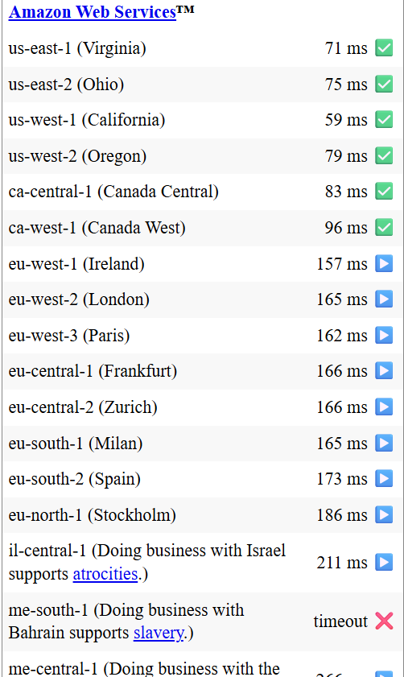

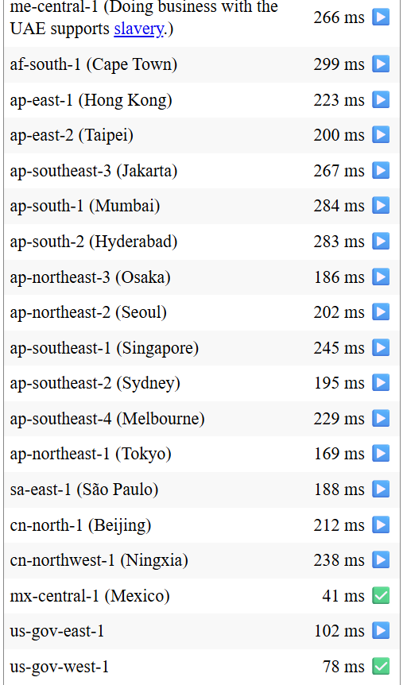

**Figura 10. Latencia Azure:**

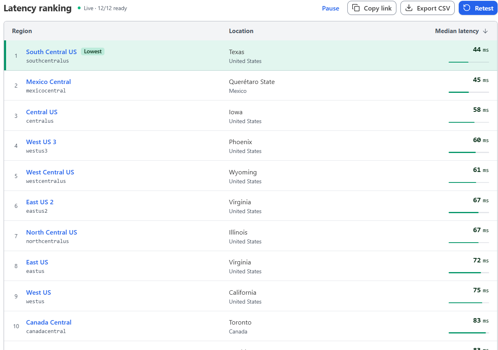

**Figura 11. Latencia Google Cloud:**

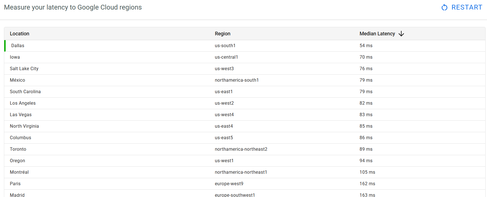

### 4.3 Análisis

**Importancia de la latencia.** La latencia indica cuánto tarda un intercambio de red, y repercute en la rapidez percibida por el usuario. Una solicitud web puede necesitar varias rondas entre navegador, API, base de datos y servicios externos; aumentos pequeños de latencia se acumulan en recorridos encadenados. Dos casos especialmente sensibles son el **control remoto industrial en tiempo real**, que requiere respuestas oportunas para una operación segura, y los **videojuegos multijugador competitivos**, donde retrasos de decenas de milisegundos pueden afectar la sincronización. No existe un umbral universal: se mide de acuerdo con cada aplicación.

**Soberanía de datos.** Tener regiones en Querétaro facilita la **residencia física de los datos** en México y puede mejorar la latencia, pero no garantiza por sí solo **soberanía jurídica**, protección de datos ni cumplimiento contractual. Deben revisarse control de acceso, ubicación de copias y logs, subprocesadores, jurisdicción aplicable, cifrado, transferencias internacionales, contratos y continuidad. Para la Mesa de Ayuda se recopilarían únicamente datos necesarios de usuarios y tickets, con avisos y controles proporcionales a su sensibilidad.

## Actividad 5. Plan de migración y ensayo integrador

### 5.1 Caso empresarial: retail mexicano, 200 empleados

**Situación inicial:** aplicación PHP/Laravel en Apache con 50 000 visitas al día; MySQL 5.7 y 100 GB; archivos compartidos de 2 TB; Exchange Server; sistema legado de inventario en Visual Basic 6 sin soporte.

### 5.2 Las siete Rs

| Estrategia | Descripción y uso típico | Ejemplo / herramienta |
|---|---|---|
| **Rehost** | Mover casi sin alterar el código o sistema operativo | Azure Migrate, AWS Application Migration Service |
| **Replatform** | Cambiar aspectos de plataforma conservando la aplicación | Migrar MySQL a BD gestionada; contenedor Linux para Laravel |
| **Refactor / Re-architect** | Rediseñar arquitectura y código | API modular, colas, contenedores y servicios cloud-native |
| **Repurchase** | Reemplazar por producto SaaS | Exchange local a Exchange Online |
| **Retire** | Dar de baja una aplicación obsoleta o innecesaria | Retiro de reportes duplicados tras validar datos |
| **Retain** | Conservar temporalmente local una aplicación | VB6 de inventario mientras se define reemplazo |
| **Relocate** | Mover VMs a plataforma de virtualización compatible sin refactor | Azure VMware Solution / VMware Cloud on AWS según contrato |

### 5.3 Asignación a los cinco componentes

| Sistema | Estrategia | Justificación y acción |
|---|---|---|
| Servidor Apache + PHP/Laravel (50 000 visitas/día) | **Replatform** | Empaquetar en contenedor Linux y publicarlo en Azure App Service para contenedores; hacer pruebas de sesiones, escritura de archivos y picos de carga |
| Base MySQL 5.7 (100 GB) | **Replatform** | Hacer backup, probar compatibilidad con MySQL 8.x, migrar a Azure Database for MySQL Flexible Server y validar integridad y consultas |
| Servidor de archivos (2 TB) | **Replatform** | Migrar a Azure Files cuando se requiera SMB; elegir Blob Storage solo si las aplicaciones pueden consumir objetos en lugar de archivos compartidos |
| Exchange Server | **Repurchase** | Adoptar Exchange Online/Microsoft 365, migrar buzones por lotes y verificar DNS/MX, identidades y correo entrante/saliente |
| Inventario Visual Basic 6 sin soporte | **Retain** temporal | Mantenerlo segmentado y respaldado mientras se construye o adquiere sustituto; no conectarlo directamente a internet |

**Estrategias que no se eligieron en la primera ola:** *rehost* y *relocate* pueden emplearse para contingencia o migraciones rápidas; *refactor* es objetivo de mediano plazo para inventarios; *retire* aplica tras verificar que funcionalidades redundantes pueden eliminarse sin afectar operación.

### 5.4 Proveedor recomendado

Se propone **Microsoft Azure** para el caso retail por (1) facilidad para integrar el correo empresarial con Exchange Online y las identidades con Entra ID, (2) región México Central para alojar aplicaciones/datos cuando los SKU estén disponibles, y (3) oferta de servicios gestionados, monitoreo y herramientas de migración. El costo exacto debe compararse con AWS y GCP; esta recomendación no supone que Azure sea siempre el más económico.

### 5.5 Estimación mensual del caso retail

Esta estimación usa **supuestos declarados**, no tarifas inventadas. La práctica no especifica cuánto almacenamiento consumen los 200 buzones, tráfico saliente ni nivel real de concurrencia, por lo que solo se podrá dar un valor aproximado tras fijar dichos parámetros y ejecutar la calculadora oficial.

| Componente de Azure | Cantidad supuesta | Unidad de cobro | Estimación USD/mes |
|---|---|---|---:|
| App Service for Containers para Laravel | 2 instancias siempre encendidas, escoger plan que soporte carga | instancia/mes | [COTIZAR] |
| Azure Database for MySQL Flexible Server | 1 instancia compatible y 100 GB de datos + backups | vCPU/mes y GB-mes | [COTIZAR] |
| Azure Files / Blob para documentos | 2 048 GB (2 TB en unidades binarias); elegir un tipo | GB-mes + operaciones | [COTIZAR] |
| Tráfico saliente | **Supuesto:** 500 GB/mes, ajustar a dato real | GB | [COTIZAR] |
| Azure Monitor / respaldos | Según retención y GB de logs | GB/mes | [COTIZAR] |
| Exchange Online para empleados | **Supuesto:** 200 buzones, licencia elegible | usuario/mes | [COTIZAR EN TARIFARIO DE MICROSOFT 365] |
| **TOTAL** | | | **[SUMAR]** |

**Evidencia:** `[INSERTAR figura: P04_A5_CostoRetail_Azure.png y cotización de Microsoft 365]`.

### 5.6 Riesgos y mitigaciones

| Riesgo | Impacto | Mitigación concreta |
|---|---|---|
| Pérdida, corrupción de datos o incompatibilidad MySQL 5.7 → 8.x | Tickets, pedidos y reportes inaccesibles; operaciones interrumpidas | Backups comprobados, ambiente de ensayo, pruebas de migración, doble lectura temporal si aplica, verificación de totales e inventario y ventana de reversión |
| Interrupción de correo / integración con sistema VB6 | Pérdida de notificaciones o bloqueo de inventarios | Migrar buzones por lotes, conservar coexistencia, probar DNS y accesos; mantener VB6 en red aislada con respaldos hasta disponer de sustituto |

### 5.7 Ensayo integrador (500–700 palabras)

**Elección de nube, oportunidades profesionales y viabilidad multinube para una PyME mexicana**

Para mi proyecto escolar de Módulo de Soporte (Mesa de Ayuda), elegiría inicialmente Microsoft Azure, aunque conservaría la posibilidad de ejecutar componentes en otra nube. La decisión no se basa en su popularidad, sino en lo que necesita una aplicación que registra tickets, adjunta archivos y permite a sus usuarios consultar el estado de cada solicitud. Azure ofrece plataformas para desplegar una API web, bases de datos gestionadas, almacenamiento de objetos y herramientas de monitoreo. Además, su integración con GitHub, la identidad de Microsoft y Application Insights puede simplificar un proyecto que necesita demostrar disponibilidad y medir tiempos de respuesta. Si califico para Azure for Students, los créditos educativos serían útiles para experimentar, pero no asumiría que el servicio seguirá siendo gratuito después del periodo promocional.

En cuanto a la curva de aprendizaje, una primera implementación debe ser sencilla. Para el prototipo utilizaría un servicio de aplicación administrado en lugar de levantar desde el inicio un clúster de Kubernetes. Esto reduce la cantidad de sistemas operativos, nodos y configuraciones que debemos mantener. Como estudiante también tomaría en cuenta el valor de las certificaciones y habilidades transferibles. Una certificación de fundamentos puede organizar el estudio; sin embargo, considero más importante demostrar un repositorio con despliegues reproducibles, autenticación adecuada, logs, alertas y una estimación honesta de costos. Estos conocimientos son útiles en AWS, Azure o Google Cloud, aun cuando cambien los nombres comerciales de los servicios.

La apertura de regiones de infraestructura en Querétaro transforma el escenario para egresados de Ingeniería en Sistemas Computacionales. Las empresas pueden desplegar recursos físicamente más cercanos a clientes mexicanos y diseñar soluciones que contemplen residencia nacional de datos. Esto crea necesidades profesionales en redes, automatización, seguridad, bases de datos, observabilidad, continuidad de negocio y FinOps. No obstante, la existencia de una región mexicana no implica que cada servicio esté disponible allí ni que todos los datos, respaldos o registros permanezcan automáticamente en territorio nacional. Un ingeniero debe verificar tanto la arquitectura como las condiciones contractuales, la privacidad y los controles operativos.

También veo oportunidades para perfiles que conecten nube y desarrollo de software. En lugar de limitarse a aprender a crear máquinas virtuales, un egresado puede especializarse en infraestructura como código, integración y entrega continua, ingeniería de confiabilidad y diseño de APIs. La inteligencia artificial amplía esta demanda: una Mesa de Ayuda podría clasificar tickets, proponer respuestas o resumir incidentes, siempre que se evalúen el precio por token, la seguridad de los datos personales y la posibilidad de que el modelo se equivoque. Una función de IA no reemplaza los procesos de atención ni la validación humana.

Respecto a la estrategia multinube, considero que es técnicamente viable para una PyME mexicana, pero no siempre resulta conveniente. Distribuir servicios entre proveedores puede mejorar la negociación comercial, reducir ciertas dependencias y ofrecer alternativas ante incidentes. Sin embargo, también genera costos de transferencia, mayor complejidad de identidad, monitoreo duplicado y necesidad de personal capacitado en varias plataformas. Si una PyME dispone de un equipo pequeño, podría perder más dinero en operación que lo que ahorra en precios de infraestructura.

Por esta razón, recomendaría iniciar con un proveedor principal, configurar respaldos exportables y documentar el despliegue mediante contenedores o herramientas automatizadas. Después evaluaría una segunda nube únicamente para funciones donde exista una ventaja medible, como recuperación ante desastres o un servicio especializado. En conclusión, la mejor elección de nube no es la que promete más servicios, sino la que permite cumplir requisitos técnicos, cuidar datos, controlar costos y mantener la aplicación operativa con las capacidades reales del equipo.

## Conclusiones del equipo

La comparación mostró que servicios con nombres diferentes pueden cubrir necesidades similares, pero su costo final no se determina solo por el precio de una máquina virtual: también intervienen discos, bases gestionadas, egreso, balanceadores, licencias y soporte. Los SLAs requieren leer la arquitectura cubierta y su forma de medición, porque una promesa de 99.99 % no equivale automáticamente a la disponibilidad de una aplicación completa. Las regiones mexicanas ofrecen oportunidades de desempeño y residencia de datos, aunque deben acompañarse de controles de privacidad y recuperación. Para el proyecto de Mesa de Ayuda conviene una arquitectura pequeña, observable y segura antes de incorporar alta complejidad o múltiples proveedores. La recomendación económica definitiva queda sujeta a las cotizaciones y mediciones adjuntas.

## Evidencias que deben insertarse antes de la entrega final

- [ ] Captura AWS Pricing Calculator: los cinco componentes y total (o varias capturas que los cubran).
- [ ] Captura Azure Pricing Calculator: los cinco componentes y total.
- [ ] Captura Google Cloud Pricing Calculator: los cinco componentes y total.
- [ ] Captura comparativa del proveedor más caro con compromiso de 1 año.
- [ ] Capturas del selector de región mexicana en **cada consola con cuenta activa**, mínimo 2 proveedores.
- [ ] Captura(s) de la herramienta de latencia para México vs EE. UU. en al menos 2 proveedores, con resultados legibles.
- [ ] Tabla completada con resultados y fórmula de reducción (%).
- [ ] Presupuesto del caso retail en Azure y tarifa de licencias Microsoft 365, con el supuesto explicitado.
- [ ] Portada definitiva: equipo, integrantes, boletas, grupo y fecha.
- [ ] Verificar cambios de tarifas, región y condiciones vigentes el día en que se toman las capturas.

## Uso de IA

Se utilizó ChatGPT (GPT-6) como apoyo para estructurar el reporte, investigar enlaces oficiales, proponer comparaciones, verificar operaciones de disponibilidad y redactar un borrador del ensayo. El equipo debe comprobar cada dato, realizar las actividades de navegador, aportar evidencias auténticas, revisar el texto con criterio propio y poder explicar las decisiones técnicas.

## Referencias (APA 7.ª ed.)

1. Amazon Web Services. (s. f.). *Amazon Compute Service Level Agreement*. https://aws.amazon.com/compute/sla/
2. Amazon Web Services. (s. f.). *Create and configure an estimate — AWS Pricing Calculator*. https://docs.aws.amazon.com/pricing-calculator/latest/userguide/create-configure-estimate.html
3. Microsoft. (2026). *Service Level Agreements (SLA) for Online Services*. https://www.microsoft.com/licensing/docs/view/Service-Level-Agreements-SLA-for-Online-Services
4. Microsoft Learn. (s. f.). *Estimate costs with the Azure pricing calculator*. https://learn.microsoft.com/en-us/azure/cost-management-billing/costs/pricing-calculator
5. Google Cloud. (s. f.). *Google Cloud Pricing Calculator*. https://cloud.google.com/products/calculator
6. Google Cloud. (s. f.). *Regions and zones — Compute Engine*. https://cloud.google.com/compute/docs/regions-zones
7. Oracle. (s. f.). *Service Level Agreements*. https://docs.oracle.com/en-us/iaas/Content/General/Reference/slastatement.htm
8. Oracle. (s. f.). *Cloud Cost Estimator*. https://www.oracle.com/cloud/costestimator.html
9. CrowdStrike. (2024, 6 de agosto). *Channel File 291 incident: Root cause analysis is available*. https://www.crowdstrike.com/en-us/blog/channel-file-291-rca-available/
10. Microsoft. (2024, 20 de julio). *Helping our customers through the CrowdStrike outage*. https://blogs.microsoft.com/blog/2024/07/20/helping-our-customers-through-the-crowdstrike-outage/
11. Microsoft Azure. (2024, 19 de julio). *Virtual Machines startup failures due to CrowdStrike Falcon Agent update issue*. https://azure.status.microsoft/en-us/status/history/?trackingId=1VT1-LX0
12. Oracle. (s. f.). *Public Cloud Regions and Data Centers*. https://www.oracle.com/cloud/public-cloud-regions/
13. Instituto Politécnico Nacional. (2025). *Práctica 4: Proveedores de servicio en la nube* [Guía de laboratorio proporcionada por el docente].

**Fecha de consulta de recursos en línea:** 25 de octubre de 2026.
