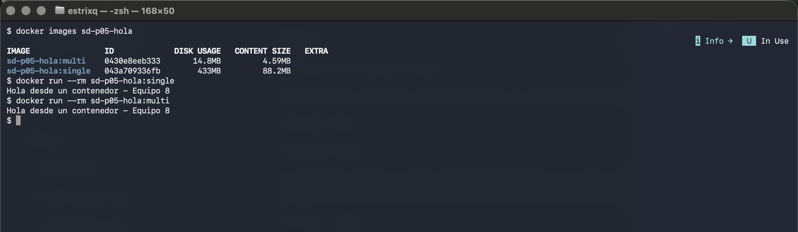
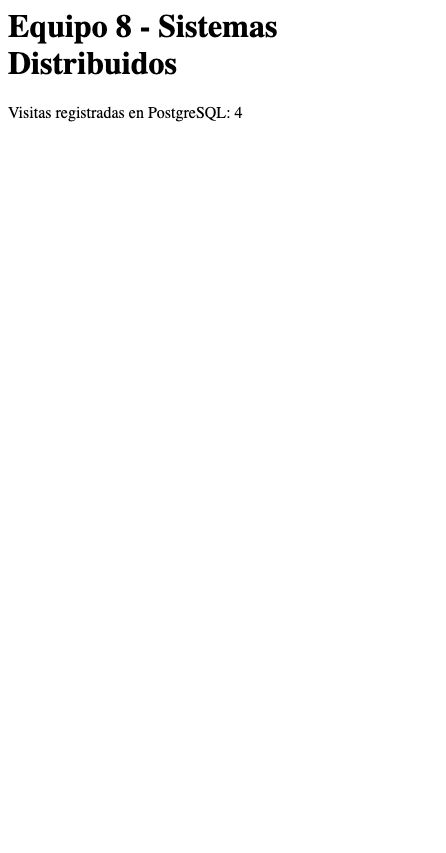
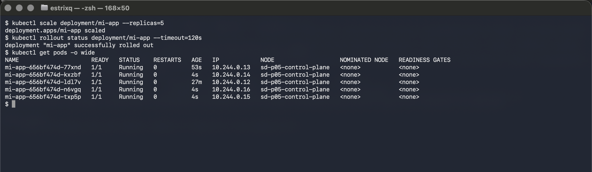
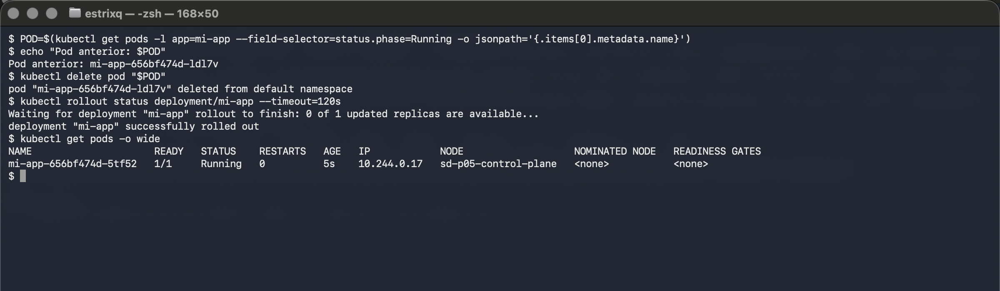

# Práctica 5 — Virtualización en el cómputo en la nube

## Datos del equipo

- **Institución:** Instituto Politécnico Nacional — Escuela Superior de Cómputo (ESCOM)
- **Carrera:** Ingeniería en Sistemas Computacionales — Plan 2020
- **Materia:** Sistemas Distribuidos
- **Grupo:** 7CV1 — Semestre 27/1
- **Profesor:** MBA. Rodrigo Ojeda Santillán
- **Equipo:** 8
- **Integrantes del equipo:** Israel Márquez Cárdenas | Esaul Tellez de la Cruz | Salvador Sandoval Garibay 

> La práctica indica modalidad individual o equipos de máximo dos personas, según el profesor. Confirmar qué integrantes corresponden a esta entrega.

---

## Introducción

La virtualización permite compartir y aislar recursos de cómputo mediante máquinas virtuales, contenedores y plataformas de orquestación. En esta práctica se comparan estos mecanismos y se documenta el uso de Docker, Docker Compose y Kubernetes en un entorno local. También se analizan tecnologías emergentes y el futuro de la virtualización.

## Estado y contenido de la práctica

- **Actividad 1 — Máquinas virtuales:** pendiente.
- **Actividad 2 — Contenedores:** imágenes de nginx y Go, y aplicación Flask con PostgreSQL mediante Compose.
- **Actividad 3 — Kubernetes:** Deployment, Service, escalado, recuperación y actualización con rollback en Kind.
- **Actividad 4 — Análisis comparativo:** tablas y respuestas en [actividades_4_5.tex](actividades_4_5.tex).
- **Actividad 5 — Ensayo integrador:** incluido en [actividades_4_5.tex](actividades_4_5.tex).

El [reporte en LaTeX](reporte.tex) reúne las actividades, preguntas, referencias y capturas. Se compila desde la raíz del repositorio; su compilación aún no se ha verificado. La carpeta [evidencias](evidencias/) contiene las capturas originales y los registros de ejecución.

## Resultados y evidencias

Al construir el ejemplo de Go, la imagen de una etapa ocupó **433 MB** y la imagen multi-stage **14.8 MB** en el entorno utilizado. La aplicación con Compose registró visitas en PostgreSQL y mostró el contador en el navegador.





En Kubernetes se verificaron dos y cinco réplicas, la reducción a una réplica, la reposición de un pod y una actualización seguida de rollback. En una prueba previa, el reemplazo alcanzó el estado `Ready` en aproximadamente tres segundos; ese tiempo depende del entorno.





El resto de las capturas y salidas se encuentran en [evidencias](evidencias/), incluidos los registros de actualización y rollback. La salida `actividad3-salida.txt` identifica un primer intento inválido de recuperación; la medición válida está en `recuperacion.txt`.

---

## Ejecución de las actividades 2 y 3

## Actividad 2. Contenedores

Los ejemplos se ejecutan desde la raíz del repositorio. Los puertos 18081, 18082 y 18083 se usan para evitar conflictos y quedan accesibles solo desde la computadora local.

```sh
docker run -d -p 127.0.0.1:18082:80 --name sd-p05-nginx nginx:alpine
docker build -t sd-p05-web:v1 practicas/P05/actividad2/web
docker run -d -p 127.0.0.1:18083:80 --name sd-p05-web-estatica sd-p05-web:v1
docker build -t sd-p05-hola:single -f practicas/P05/actividad2/multistage/Dockerfile.single practicas/P05/actividad2/multistage
docker build -t sd-p05-hola:multi practicas/P05/actividad2/multistage
docker images sd-p05-hola
docker run --rm sd-p05-hola:single
docker run --rm sd-p05-hola:multi
docker inspect sd-p05-web-estatica
docker logs sd-p05-web-estatica
docker stats --no-stream sd-p05-web-estatica
docker compose -p sd-p05 -f practicas/P05/actividad2/compose/docker-compose.yml up -d --build
```

Abrir `http://localhost:18082` para nginx, `http://localhost:18083` para la página personalizada y `http://localhost:18081` para el contador de visitas. La contraseña de PostgreSQL es exclusivamente para esta práctica local.

Para detener solo estos contenedores, sin afectar otros proyectos:

```sh
docker rm -f sd-p05-nginx sd-p05-web-estatica
docker compose -p sd-p05 -f practicas/P05/actividad2/compose/docker-compose.yml down
```

El volumen `sd-p05_datos` conserva las visitas. `docker compose down -v` también lo elimina. No se ejecuta `docker system prune -a`, pues afecta recursos de otros proyectos.

## Actividad 3. Kubernetes

Con Kind y kubectl instalados, desde la raíz del repositorio:

```sh
kind create cluster --name sd-p05 --config practicas/P05/actividad3/kind-config.yaml --kubeconfig /tmp/sd-p05-kubeconfig --wait 180s
export KUBECONFIG=/tmp/sd-p05-kubeconfig
kubectl get nodes
kubectl apply -f practicas/P05/actividad3/deployment.yaml -f practicas/P05/actividad3/service.yaml
kubectl rollout status deployment/mi-app
kubectl get pods,service -o wide
kubectl scale deployment mi-app --replicas=5
kubectl rollout status deployment/mi-app
kubectl get pods -o wide
kubectl scale deployment mi-app --replicas=1
kubectl rollout status deployment/mi-app
kubectl get pods -o wide
kubectl delete pod <nombre-del-pod>
kubectl get pods -w
kubectl set image deployment/mi-app nginx=nginx:1.27-alpine
kubectl rollout status deployment/mi-app
kubectl rollout undo deployment/mi-app
kubectl rollout status deployment/mi-app
```

El Service NodePort se publica en `http://localhost:18080`. Para eliminar solo el clúster de la práctica: `kind delete cluster --name sd-p05`. El archivo de configuración separado evita cambiar el contexto habitual de Kubernetes.

## Reporte y estado

El archivo `reporte.tex` es el documento principal y se compila desde la raíz del repositorio con pdfLaTeX. Las actividades 2 a 5 están redactadas; la actividad 1 está pendiente. El código y las capturas del navegador se encuentran en esta carpeta. Se conservaron las salidas y las capturas originales de las pruebas; las versiones recortadas se usan en el reporte para facilitar su lectura. La salida `actividad3-salida.txt` identifica un primer intento inválido de recuperación; la prueba válida está en `recuperacion.txt`. No se ha verificado la compilación LaTeX en este equipo.
